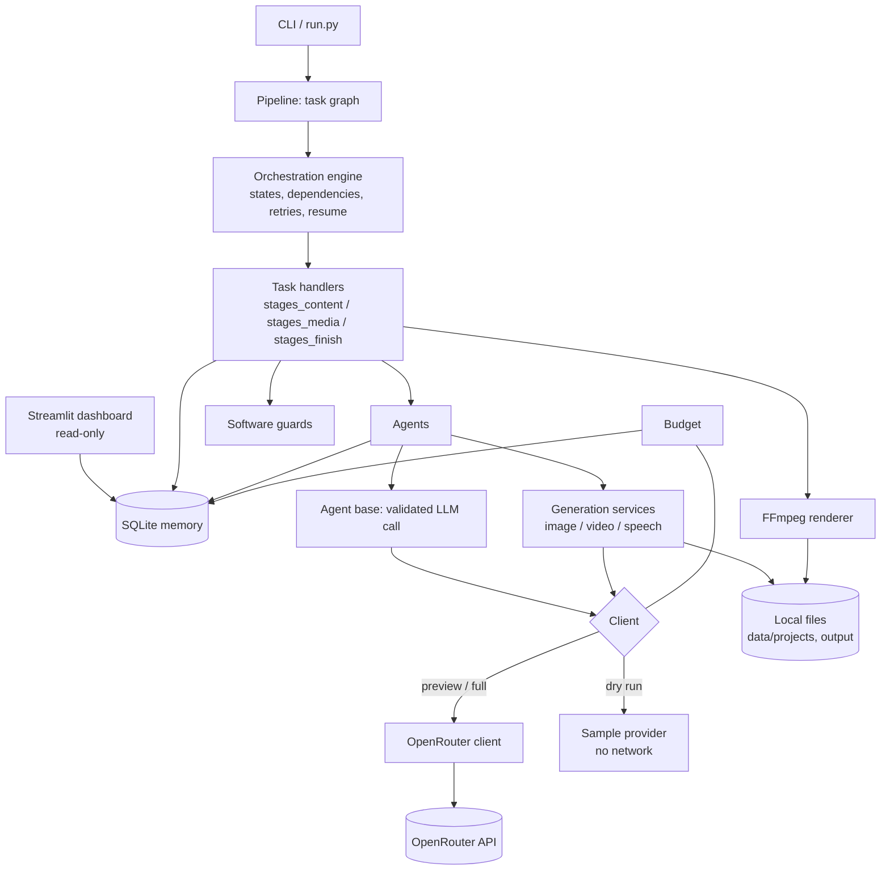
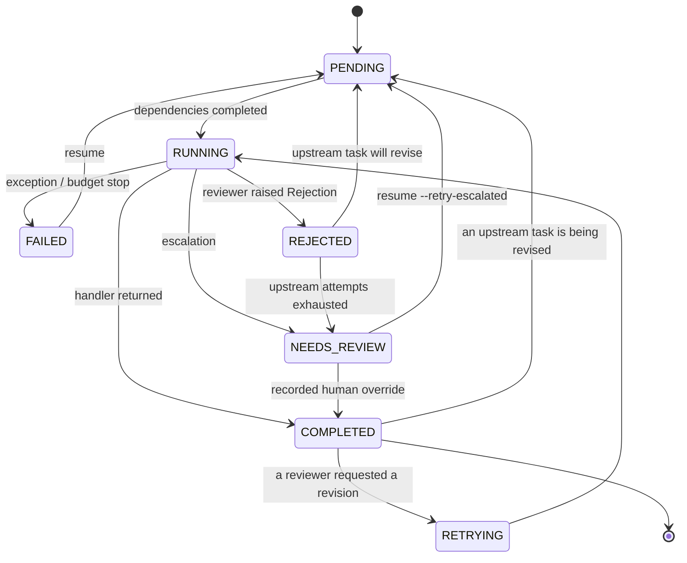
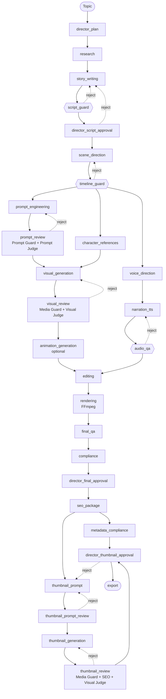
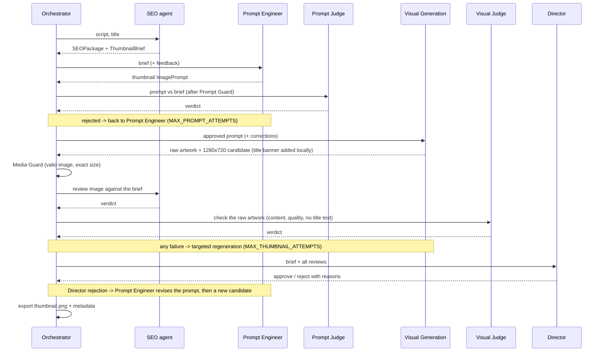
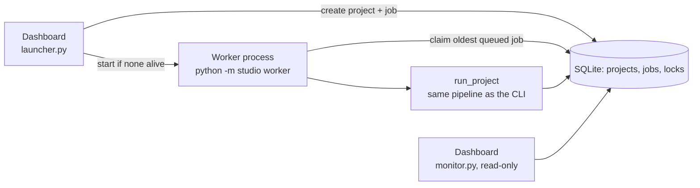

# AI Video Studio - System Documentation

This document describes the system as it is implemented in this repository. Each capability
is marked as **implemented**, **partial** or **optional**, and section 4 lists what is not done.

Status legend used below:

- **Implemented**: code exists and is covered by the automated tests and/or the dry run.
- **Implemented, live-untested**: code exists and is tested against mocked OpenRouter
  responses, but has not been executed against the paid endpoints during development.
- **Optional**: off by default, enabled by configuration.

---

## 1. Project introduction

AI Video Studio is a Python application that produces a complete YouTube-style video from a
single topic. It behaves like a small production studio: a Director sets the creative
direction and specialised agents research, write, storyboard, design prompts, generate images
and narration, edit, review and package the result. A deterministic workflow engine executes
the work, stores every step in a local SQLite database and can resume after failures.

The default format is "Your Life as Every Rank in [TOPIC]", a 10-minute, 16:9, 1080p English
video with a consistent 2D cartoon look. Topic, duration, resolution and all other parameters
are configuration, not code.

## 2. Problem statement

Producing an explainer video requires many different skills (research, writing, visual
design, voice, editing, quality control, packaging) and many hand-offs. A single large
language model prompt cannot do this reliably: output is long, multi-modal, expensive and
error-prone, and errors found late are costly. The problem is to coordinate specialised AI
components so that each piece of work is checked, only faulty pieces are redone, cost stays
under control and the whole process is traceable and repeatable on one machine.

## 3. Project objectives

1. Turn a topic into a finished MP4, thumbnail and metadata package without manual steps.
2. Separate creative decisions (LLM agents) from execution and arithmetic (deterministic code).
3. Validate every agent output against a schema and every media file against software guards.
4. Use bounded feedback loops instead of unlimited regeneration.
5. Keep all data, logs and media local; use OpenRouter as the only external service.
6. Make costs visible and enforce a budget.
7. Stay simple enough for a student team to read, test and extend.

## 4. Scope and limitations

In scope: everything from topic to exported local files. Out of scope by design: uploading
to YouTube, YouTube analytics, web browsing or scraping, cloud storage, hosted databases.

| Capability | Status |
| --- | --- |
| Workflow engine, states, dependencies, retries, resume, human override | Implemented |
| SQLite unified memory | Implemented |
| Software guards (script, timeline, prompt, media, audio, final video) | Implemented |
| Dry-run mode with labelled placeholder media | Implemented |
| FFmpeg rendering (pan/zoom stills, fades, captions, narration, optional music) | Implemented |
| CLI, cost/evaluation reports | Implemented |
| Dashboard: start, batch, queue, monitor, media, recovery (Streamlit) | Implemented (tested with Streamlit's test runner and sample data; timed refresh not observed in a browser during development) |
| Local job queue and background worker | Implemented |
| LLM agents and judges through OpenRouter chat completions | Implemented, live-untested |
| Image generation (`POST /images`) | Implemented, live-untested |
| Text to speech (`POST /audio/speech`) | Implemented, live-untested |
| Model capability check against the OpenRouter catalog | Implemented (verified against the live catalog) |
| AI video clips (`POST /videos`, async job) | Optional, live-untested |
| Transcription comparison in Audio QA (`POST /audio/transcriptions`) | Optional, live-untested |
| Background music | Optional (requires a file and a recorded licence) |
| Sound effects | Not implemented |
| Parallel execution of the visual and narration branches | Not implemented (independent, but run one after the other) |
| Visual Judge review of video clips | Not implemented (Media Guard only) |
| Cross-fade transitions between scenes | Not implemented (fade out / fade in and cuts) |

Other limitations: caption timing inside a scene is estimated from word counts; the final
duration follows the measured narration and is never forced by cutting speech; character
consistency depends on the chosen image model; compliance checks are screening aids only.

## 5. High-level architecture



Source layout:

| Path | Responsibility |
| --- | --- |
| `src/studio/config.py` | Typed settings, modes, validation |
| `src/studio/schemas/` | Pydantic contracts exchanged between components |
| `src/studio/memory/` | `MemoryStore` (SQLite) |
| `src/studio/orchestration/engine.py` | Generic task engine |
| `src/studio/orchestration/pipeline.py` | Task graph, project creation, run/resume, human override |
| `src/studio/orchestration/stages_*.py` | Task handlers that connect agents, guards and memory |
| `src/studio/orchestration/context.py` | Run context, budget, project directories |
| `src/studio/orchestration/outputs.py` | Mirrors work files and status into `output/<project>/` |
| `src/studio/agents/` | The 13 agents and the shared `Agent` base |
| `src/studio/guards/` | Deterministic guards |
| `src/studio/evaluation/audio_qa.py` | Audio QA component |
| `src/studio/services/openrouter.py` | The single OpenRouter client |
| `src/studio/services/mock.py` | Dry-run sample provider with the same interface |
| `src/studio/services/generation.py` | Image, video and speech services |
| `src/studio/services/placeholders.py` | Labelled placeholder media |
| `src/studio/rendering/` | ffmpeg/ffprobe wrappers and the timeline renderer |
| `src/studio/cli.py`, `run.py` | Command line interface |
| `src/studio/orchestration/jobs.py`, `locks.py` | Local job queue, background worker, heartbeat locks |
| `dashboard/app.py`, `monitor.py`, `launcher.py` | Dashboard page, its read-only queries, its actions |
| `tests/` | pytest suite |

## 6. Complete agent list

| # | Agent | Module | Uses an LLM | Model setting |
| --- | --- | --- | --- | --- |
| A | Director | `agents/director.py` | yes | `DIRECTOR_MODEL` |
| B | Research | `agents/research.py` | yes | `LLM_MODEL` |
| C | Story Writer | `agents/story_writer.py` | yes | `LLM_MODEL` |
| D | Scene Director | `agents/scene_director.py` | yes | `LLM_MODEL` |
| E | Prompt Engineer | `agents/prompt_engineer.py` | yes | `LLM_MODEL` (`THUMBNAIL_MODEL` for the thumbnail prompt) |
| F | Prompt Judge | `agents/judges.py` | yes | `LLM_MODEL` (`THUMBNAIL_MODEL` for the thumbnail prompt) |
| G | Visual Generation | `agents/visual_generation.py` | image / video models | `IMAGE_MODEL`, `VIDEO_MODEL` |
| H | Visual Judge | `agents/judges.py` | yes (vision) | `VISION_MODEL` (`THUMBNAIL_MODEL` for thumbnails) |
| I | Voice Director (+ Audio QA) | `agents/voice_director.py`, `evaluation/audio_qa.py` | yes + speech model | `LLM_MODEL`, `TTS_MODEL` |
| J | Editor | `agents/editor.py` | no (deterministic rules) | - |
| K | Final QA | `agents/final_qa.py` | deterministic + one LLM review | `LLM_MODEL` |
| L | SEO & Growth | `agents/seo.py` | yes (+ vision for review) | `LLM_MODEL`, `THUMBNAIL_MODEL` (thumbnail review) |
| M | Compliance | `agents/compliance.py` | deterministic + LLM screening | `LLM_MODEL` |

Several agents share one LLM by default; each role can be pointed at a different model.

## 7. Individual agent responsibilities

**Director.** Creates the production plan (creative goals, audience, tone, chapter list with
target seconds) and the Style Bible; reviews the script; gives final approval of the video
and of the thumbnail. It reads a concise progress summary from memory
(`MemoryStore.progress_summary`). It only returns decisions: state changes, retries and file
handling are done by the engine. It cannot approve when compliance is blocked (section 23).

**Research.** Reads local `.txt`/`.md` files (from `--sources` or `data/references/`),
produces a brief with one research chapter per planned chapter and a list of claims. Each
claim is `verified_source` (with the id of a local file), `background_knowledge` or
`uncertain`. Code then re-checks every citation: a claim citing a source that does not exist
locally is downgraded to `uncertain`. With no files, the brief states that all facts are
unverified model knowledge. There is no browsing.

**Story Writer.** Writes narration one chapter at a time, with the chapter's word target,
research notes, tone, the previous chapter's last sentence and (on revision) the reviewer's
feedback. Chapter one must open with the hook; the last chapter must close the video.

**Scene Director.** Receives a chapter as numbered sentences and returns scenes and shots
that reference sentence ranges, plus the visual description, framing, camera move and media
type of each shot. Because it refers to sentences by number it cannot change the approved
wording. Code verifies that every sentence is covered exactly once and computes durations
and timestamps.

**Prompt Engineer.** Writes one image prompt per shot (batched per scene) using the Style
Bible; writes an animation prompt for shots marked as animation; revises individual prompts
from judge feedback; converts the SEO thumbnail brief into a thumbnail prompt. The final text
sent to the image model is assembled by `compose_image_prompt` (prompt + composition +
lighting + character descriptions + style + exclusions + corrections).

**Prompt Judge.** Compares each prompt with its shot under the shared `SHOT_RULES` and returns
a scored verdict per shot, with a `fault` field naming who must fix a rejection: the Prompt
Engineer (`prompt`) or the Scene Director (`scene`, the required picture itself cannot be drawn).
Also checks the thumbnail prompt against the SEO brief.

**Visual Generation.** Calls the image service for shots, character references and thumbnail
candidates and the video service for optional clips; passes reference images when the model
supports them; stores prompt, model, cost and limitations with every asset; regenerates with
the reviewer's corrections appended. It finishes thumbnails locally (crop to 1280x720, draw
text with Pillow).

**Visual Judge.** Sends the image and the request to a vision model and returns a verdict on
content match, character consistency, composition/style and major visual errors.

**Voice Director.** One LLM call decides delivery instructions and speed; code creates one
narration segment per scene with the configured stock voice; the speech service generates the
audio. **Audio QA** then verifies each file (section 18).

**Editor.** Builds the `EditingTimeline` from the storyboard, approved visuals and measured
narration durations using fixed rules (section 19). No LLM call.

**Final QA.** Runs the Final Video Guard, scans the audio track for long silences and asks
an LLM to review narrative continuity from the chapter openings/endings and the scene list.

**SEO & Growth.** Produces title options, description, tags, keywords, hook and retention
suggestions and the thumbnail brief; reviews the generated thumbnail against its own brief
with the vision model. Output carries a disclaimer that no analytics were used and nothing is
a performance prediction.

**Compliance.** Builds a checklist per production from deterministic checks and LLM
screening, marks unautomatable items as needing human review and blocks approval when a
mandatory item fails (section 23).

## 8. Agent inputs and outputs

| Agent | Inputs | Output (schema) |
| --- | --- | --- |
| Director | `ProjectBrief`; later `Script` + guard result; final evaluations + `ComplianceReport`; `ThumbnailBrief` + evaluations | `ProductionPlan`, `StyleBible`, `DirectorDecision` |
| Research | topic, `ProductionPlan`, local source files | `ResearchBrief` |
| Story Writer | `ChapterPlan`, word target, `ResearchBrief`, `StyleBible`, feedback | `Chapter` (assembled into `Script`) |
| Scene Director | `Chapter`, `StyleBible`, feedback | `Scene` with `Shot`s (assembled into `Storyboard`) |
| Prompt Engineer | `Scene`/`Shot`s, `StyleBible`, `ThumbnailBrief`, feedback | `ImagePrompt`, `AnimationPrompt` |
| Prompt Judge | shots + prompts + `StyleBible`; thumbnail prompt + brief | `EvaluationResult` |
| Visual Generation | approved `ImagePrompt`/`AnimationPrompt`, `StyleBible`, feedback | `MediaAsset` |
| Visual Judge | image file, `ImagePrompt`, `StyleBible` | `EvaluationResult` |
| Voice Director | `Storyboard`, `ProductionPlan` | `NarrationSegment`s, audio `MediaAsset`s |
| Audio QA | `NarrationSegment`, audio asset | `EvaluationResult` |
| Editor | `Storyboard`, approved visual and audio assets | `EditingTimeline` |
| Final QA | video file, `EditingTimeline`, `Storyboard`, `Script` | `EvaluationResult`s |
| SEO & Growth | `Script`, `ProductionPlan`, art style; thumbnail image | `SEOPackage`, `ThumbnailBrief`, `EvaluationResult` |
| Compliance | `Script`, `ResearchBrief`, all `MediaAsset`s, `SEOPackage` | `ComplianceReport` |

## 9. Agent communication

Agents never call each other. A task handler loads validated artifacts from memory, calls
one agent, validates and stores the result. The next handler reads it from memory. For
example the SEO agent's `ThumbnailBrief` reaches the Visual Generation agent only as a stored
artifact passed in by the `thumbnail_generation` handler.

All messages are Pydantic models (`schemas/__init__.py`). Every persisted model derives from
`Record` (id, project id, parent id, creation timestamp, status, version). An LLM reply is
accepted only after `Agent.ask` has parsed it as JSON and validated it against the expected
schema; otherwise the model is shown the validation error and asked again, at most
`MAX_LLM_REPAIR_ATTEMPTS` times, after which the task fails with `AgentOutputError`. Bookkeeping
fields are removed from the schema shown to the model and are filled in by code.

Rejections travel as `RevisionRequest` objects (target artifact, target task, responsible
agent, requester, issues, suggested changes).

## 10. Director orchestration logic

The Director decides; the engine executes. Decision points:

| Point | Director action | On rejection |
| --- | --- | --- |
| `director_plan` | Establishes plan and Style Bible | Plan with a wrong chapter count is sent back once |
| `director_script_approval` | Approves or rejects the script, optionally per chapter | Named chapters are rewritten by the Story Writer |
| `director_final_approval` | Approves the finished video using QA and compliance reports | Escalated to a human (re-making a whole video is not automatic) |
| `director_thumbnail_approval` | Final approval of the thumbnail | The Prompt Engineer revises the thumbnail prompt with the Director's reasons, then a new candidate is generated |

Every decision is stored in the `decisions` table with its reasons. Retry limits and the
budget are enforced by the engine and the `Budget` class, so the Director cannot exceed them.

## 11. Unified memory architecture

One SQLite file, `data/studio.db`, accessed only through `MemoryStore` with parameterised SQL.

| Memory category | Tables | Content |
| --- | --- | --- |
| Working | `tasks`, `working_memory` | Current task states, attempts, pending feedback, current task |
| Episodic | `agent_runs`, `task_events`, `evaluations`, `revisions`, `errors`, `decisions`, `costs` | What happened, in order, with model ids, durations and costs |
| Semantic | `knowledge` | Durable project facts: creative goals, tone, art style, voice plan, limitations |
| Artifact | `artifacts`, `assets` | Versioned JSON artifacts; media metadata with local file paths |
| Queue | `jobs`, `locks` | Background jobs (project, kind, status, start and finish time) and heartbeat locks |

Also `projects` (topic, title, mode, status, budget, final approval). `artifacts` stores every
version of each `(kind, key)` pair, for example every script version or every revision of a
shot's prompt. Media bytes are never stored in SQLite; `assets.path` points to the file.

Agents are given only what they need: the Story Writer gets one chapter's research, the
Prompt Engineer one scene, a judge one scene or one image. The Director reads
`progress_summary()` (about ten lines) rather than the history. There is no vector memory.

## 12. Workflow execution

The engine (`orchestration/engine.py`) runs a list of `TaskSpec(name, agent, handler,
depends_on, max_attempts)`. Task states: `PENDING`, `RUNNING`, `COMPLETED`, `REJECTED`,
`RETRYING`, `FAILED`, `NEEDS_REVIEW`.



Rules:

- A task runs only when all its dependencies are `COMPLETED`.
- A reviewer task raises `Rejection(target_task, requests)`. The target becomes `RETRYING` and
  receives the requests as feedback; every task downstream of it returns to `PENDING`.
- The target's attempt counter is bounded by its `max_attempts`. When it is exhausted both
  the target and the reviewer become `NEEDS_REVIEW`. There are no unbounded loops.
- An unexpected exception marks only that task `FAILED`; tasks on independent branches keep
  running. A budget stop halts the whole run.
- Every state change is appended to `task_events`. State lives in SQLite, so `resume`
  continues from the last completed task; handlers skip artifacts that are already approved.

The task graph (`pipeline.build_specs`):



The narration branch (`voice_direction` -> `narration_tts` -> `audio_qa`) depends only on the
approved storyboard, so it proceeds even if the visual branch fails. Both branches are run in
sequence by a single process.

## 13. Software guards

All guards are plain Python in `guards/__init__.py`; none calls an LLM. Each returns an
`EvaluationResult` with criteria, issues, suggested changes and metrics.

| Guard | Checks |
| --- | --- |
| Script Guard | Hook present; chapters match the plan; chapter count in range; no (near-)empty chapter; total words within tolerance of `TARGET_DURATION_S * WORDS_PER_MINUTE / 60`; estimated duration |
| Timeline Guard | Scene, shot and chapter order; contiguous timestamps (no gaps or overlaps); scene duration equals the sum of its shots; each shot within `MIN/MAX_SHOT_SECONDS`; shots cover each chapter's narration exactly; total duration within tolerance |
| Prompt Guard | Prompt text present; parent shot/brief exists; supported media type; negative prompt and aspect ratio (images); positive duration (animations) |
| Media Guard | File exists and is not empty; decodes fully (not corrupt); PNG/JPEG/WEBP; minimum width; aspect ratio; exact size for thumbnails; for clips: video stream and plausible duration via ffprobe |
| Audio Guard | File exists; MP3/WAV; measured duration; duration consistent with the text length |
| Final Video Guard | MP4 container; video and audio streams; exact resolution and aspect ratio; duration within the accepted range and equal to the timeline; every shot present in the timeline; no missing asset files |

**Accepted final duration** (`Settings.duration_bounds`, inclusive, compared at 0.1 s precision):

| Mode | Accepted range | Configured by |
| --- | --- | --- |
| Full production, dry run | target x (1 +/- tolerance): 540-660 s for a 600 s target | `TARGET_DURATION_S`, `DURATION_TOLERANCE` |
| Preview (60 s target) | 50-80 s | `PREVIEW_MIN_DURATION_S`, `PREVIEW_MAX_DURATION_S` |

The preview window exists because real speech rarely matches a word-count estimate on a
short sample (the first live preview produced 68 s for a 60 s target). It is applied only by
`Settings.for_mode(PREVIEW)`; full-production validation does not read it. The Script and
Timeline Guards still aim at the target with the percentage tolerance. A video outside the
range is never stretched, trimmed or regenerated: the guard fails and a human decides.

## 14. LLM evaluation and feedback loops

Judges return a `Verdict` (approved, score 0-1, criteria, explanation, issues, suggested
changes). An evaluation passes only if the judge approved **and** the score reaches the
configured threshold (`PROMPT_JUDGE_THRESHOLD`, `VISUAL_JUDGE_THRESHOLD`,
`THUMBNAIL_THRESHOLD`). Guards run first; a judge is only consulted for artifacts that passed
the guard.

| Loop | Reviewer | Redone by | Granularity | Limit |
| --- | --- | --- | --- | --- |
| Script | Script Guard, Director | Story Writer | Only the chapters named in the feedback | `MAX_SCRIPT_ATTEMPTS` |
| Storyboard | Timeline Guard | Scene Director | Only the faulty chapters (other scenes keep their ids and assets) | `MAX_STORYBOARD_ATTEMPTS` |
| Prompts | Prompt Guard, Prompt Judge | Prompt Engineer | Only rejected prompts | `MAX_PROMPT_ATTEMPTS` |
| Shot visuals | Prompt Judge | Scene Director | Only the visual description of the shots sent back (narration, timing and recordings kept) | `MAX_STORYBOARD_ATTEMPTS` |
| Images | Media Guard, Visual Judge | Visual Generation | Only rejected images, with corrections appended to the prompt | `MAX_VISUAL_ATTEMPTS` |
| Narration | Audio QA | Voice Director / TTS | Only rejected segments | `MAX_AUDIO_ATTEMPTS` |
| Thumbnail prompt | Prompt Guard, Prompt Judge | Prompt Engineer | The thumbnail prompt | `MAX_PROMPT_ATTEMPTS` |
| Thumbnail image | Media Guard, SEO review, Visual Judge | Visual Generation | A new candidate | `MAX_THUMBNAIL_ATTEMPTS` |
| Thumbnail concept | Director | Prompt Engineer | The thumbnail prompt, then a new candidate | `MAX_PROMPT_ATTEMPTS` |

When a limit is reached the tasks become `NEEDS_REVIEW`. A human can then fix the cause and
`resume --retry-escalated`, or accept the current artifacts with `override ... --reason`,
which is stored in `decisions` and marks them `human_approved`.

## 15. Script and scene generation

1. The Director's plan gives each chapter a share of the target duration. `chapter_word_targets`
   converts that into words per chapter.
2. The Story Writer writes each chapter separately. Each chapter is saved as soon as it is
   written, so a failure does not lose earlier chapters.
3. The Script Guard checks length and structure. Chapters more than the tolerance away from
   their target are sent back individually.
4. The Director reviews the complete script.
5. The Scene Director storyboards each chapter. `split_sentences` numbers the sentences;
   the model returns shots as sentence ranges; `coverage_problem` rejects any gap or overlap
   (one targeted repair, then failure); `retime` assigns shot durations from word counts and
   contiguous timestamps.
6. The Timeline Guard validates the storyboard before any money is spent on media.

## 16. Image and video generation

Images (**implemented, live-untested**): `ImageService` checks the budget, calls
`POST /api/v1/images` with `model`, `prompt`, `aspect_ratio` and, when supported,
`input_references`. The base64 result is decoded, opened with Pillow to prove it is an image,
normalised to PNG and stored with model, prompt, cost and provenance. One image per shot;
stills are animated with pan/zoom at render time.

Video (**optional, live-untested**): with `ENABLE_VIDEO=true` (or `--enable-video`) the Scene
Director may mark at most one shot per chapter as an animation; `MAX_VIDEO_CLIPS` caps the
total (1 in preview mode). `VideoService` submits `POST /api/v1/videos`, polls
`GET /api/v1/videos/{id}` every `VIDEO_POLL_INTERVAL_S` until `completed`, `failed`,
`cancelled`, `expired` or the `VIDEO_TIMEOUT_S` deadline, then downloads the MP4 (the
authenticated content URL, or the pre-signed URL without credentials). The approved still is
sent as the first frame when the model supports it. A clip that fails generation or the Media
Guard is not retried: the approved still image is used for that shot and the fact is recorded
in the errors and limitations. With video disabled the image workflow is complete on its own.

Feature switches: `ENABLE_IMAGES=false` or `ENABLE_TTS=false` replace generation with clearly
labelled local placeholders (`is_sample=true`), which the compliance report flags.

## 17. Character consistency

The Director's **Style Bible** (per project, stored as an artifact) defines original
characters (appearance, clothing), art style, colour palette, environment and framing
guidelines and a negative prompt.

- `character_references` generates a reference image for up to `MAX_REFERENCE_IMAGES`
  characters, checks it with the Media Guard and the Visual Judge and stores approved
  references under `data/projects/<id>/references/`.
- The Prompt Engineer receives the Style Bible; `compose_image_prompt` repeats the character
  descriptions, style and exclusions in every image request.
- When the image model accepts reference images (detected from the catalog, capped at the
  model's maximum), approved references are sent with every shot and thumbnail request.
- The Visual Judge receives the Style Bible and scores character consistency.
- When references cannot be used, the limitation is written to the Style Bible, the
  `knowledge` table and the quality report. The system never claims perfect consistency.

## 18. Voiceover generation

(**Implemented, live-untested.**) One narration segment per scene keeps each speech request
short while giving the editor an exact measured duration per scene. `SpeechService` calls
`POST /api/v1/audio/speech` with `model`, `input`, `voice`, `response_format` and, only when
applicable, `speed` and `instructions`. MP3 is saved as is; raw PCM is wrapped into WAV using
the sample rate from the response header or `TTS_PCM_SAMPLE_RATE`. Only stock voices are
used; no reference audio is ever sent, so voice cloning is not possible through this system.

Audio QA per segment:

| Check | Method |
| --- | --- |
| File validity and duration | ffprobe (or the `wave` module for WAV) |
| Timing | Measured duration between 0.4x and 2.2x of the word-count estimate |
| Excessive silence | ffmpeg `silencedetect`: silence at most 35% of the clip and no gap above 3 s |
| Transcription comparison | Only if `STT_MODEL` is set: transcript similarity of at least 80% |

When no transcription model is configured the evaluation records "not performed" and the
quality report lists it as a limitation; nothing is claimed to be verified.

## 19. Video assembly

The Editor produces the timeline; `rendering/renderer.py` executes it with FFmpeg. All
commands are argument lists passed to `subprocess.run` without a shell.

Editing rules:

- Scene length = measured narration + 0.35 s pause. If the total would be below the minimum
  accepted duration (section 13), up to 1.5 s more pause per scene is added and noted. Narration is never
  trimmed; if it is too long the note says so and the Final Video Guard decides.
- Inside a scene, shots share the narration time in proportion to their word counts, with a
  minimum of 0.5 s, quantised to whole frames so video and audio lengths match exactly.
- First shot of a scene fades in, last shot fades out; other shots cut.
- Captions are short chunks (about 9 words) timed proportionally inside each shot.
- A generated clip replaces the still for its shot; if shorter than the shot its last frame
  is held.
- Music is added only when `MUSIC_PATH` and `MUSIC_LICENSE` are both set, looped and mixed
  under the narration at `MUSIC_VOLUME`.

Render steps: (1) one H.264 clip per shot (`zoompan` on a 2x upscaled still, fades, caption
PNGs drawn with Pillow and overlaid), (2) concat without re-encoding, (3) each narration file
padded with silence to its slot and concatenated, (4) optional music mix, (5) mux to MP4
(AAC audio, `+faststart`) and write `captions.srt`. Captions are drawn with Pillow because
many FFmpeg builds lack the `subtitles`/`drawtext` filters.

## Prompt Judge route to the Scene Director

A live run stopped for human review after nine review passes on the same few shots. The Scene
Director had asked for pictures the Style Bible forbids (a button labelled with a word, a
percentage, dollar signs, red bars outside the palette, a costume over the fixed outfit). The
Prompt Engineer could satisfy the shot or the Style Bible, never both, and the Prompt Judge
rejected each choice in turn. Three changes remove that loop:

- **One rule set, `SHOT_RULES`** (`agents/prompt_engineer.py`), shown word for word to the Scene
  Director, the Prompt Engineer, the Prompt Judge and the Visual Judge for shot images. It settles
  outfit, palette (one signal accent colour is allowed), writing (always replaced by a wordless
  stand-in, which is never a "missing detail"), the fact that software appends character
  descriptions, and one moment per shot. The Scene Director now also receives the Style Bible, so
  it stops requesting forbidden pictures in the first place.
- **The Prompt Judge can reach the Scene Director.** `prompt_review` raises a `Rejection` towards
  `scene_direction` (request kind `shot_visual`) for a shot when the judge sets `fault: scene`, or
  when the Prompt Engineer has used all its attempts and the prompt is still rejected.
  `rewrite_visuals` then has the Scene Director describe a different picture for those shots
  only. Narration, timing and ids are unchanged, so no audio is re-recorded; the old prompt is
  marked `stale` and written again from scratch, and the Prompt Engineer gets fresh attempts.
  The route is bounded by `MAX_STORYBOARD_ATTEMPTS` (shared with the Final QA trim); when the
  Scene Director has no attempt left the loop escalates to a human as before.
- **Resume uses the last verdict.** A rejected prompt whose request did not arrive as task
  feedback (resume after an escalation) is revised with the judge's last failed evaluation instead
  of being re-judged unchanged.

## Image review rules, stronger-model redraws and the live log

**What the logs showed.** In one run 57 of 100 shot images were rejected, most of them for "five
fingers instead of four" (a Style Bible detail no image model controls), and the run stopped with
13 shots unapproved. In the next run the SEO agent approved all three thumbnail candidates (0.88
each) but the Visual Judge rejected them for prompt details such as an open laptop or a room that
was not isometric; every rewrite added constraints and the score fell from 0.60 to 0.35.

- **`IMAGE_REVIEW_RULES`** (`agents/prompt_engineer.py`) are part of every Visual Judge call. The
  prompt is a means, not a checklist. Rejection is reserved for what a viewer notices at a glance
  (wrong subject, off-model character, wrong art style, readable writing, glaring defects);
  finger counts, exact angles, prop details and shades are notes.
- **Thumbnail review** judges the picture against the SEO brief (concept, main subject, emotion)
  instead of the literal prompt. The Prompt Engineer keeps thumbnail prompts under about 120 words
  and answers a rejection by simplifying the picture, not by adding constraints.
- **`IMAGE_RETRY_MODEL`** (default `google/gemini-3-pro-image`): a shot image the Visual Judge
  rejected is redrawn by this stronger model; first pictures still come from `IMAGE_MODEL`. A
  resume after an escalation also starts from the last review of each rejected picture.
- **The Director** no longer puts uncontrollable requirements (such as a number of fingers) into
  the Style Bible.

**Live log.** `python run.py watch [project-id]` (module `studio/watch.py`) follows a production
from a second terminal. It is read-only: it polls the SQLite memory and prints task state changes,
every model call with a digest of the agent's answer (stored in `agent_runs.detail`), failed
checks with their issues, revision requests (who asks whom to redo what), decisions and errors.
Without a project id it follows the production running now, otherwise the latest one. `--history`
prints the whole log first, `--tail N` the last N events, `--once` prints and exits.

## Final QA duration rework and background music

**Too-long video.** When the Final Video Guard fails only because the rendered video is longer
than the accepted range, `final_qa` no longer stops for a human. It measures the narrator's real
pace (seconds per word), works out how many words must go to reach the target, and raises a
rejection towards `scene_direction` (`target_kind` `duration_trim`). The Scene Director picks
whole sentences to remove (`scene.trim`); code refuses to drop a chapter's first or last
sentence, more than half of a chapter, or anything that would leave a shot under the minimum
length. Wording is never changed, shots keep their ids so approved images are reused, the script
is updated to the trimmed wording, unchanged scenes keep their recording, and the measured pace
replaces `WORDS_PER_MINUTE` for the rest of the project (`measured_wpm` in project memory). The
engine then re-runs narration for the changed scenes, editing, rendering and Final QA. The loop is
bounded by `MAX_STORYBOARD_ATTEMPTS`. Final QA still escalates to a human when another check
failed, the video is too short, more than 40% of the words would have to go, or no cut of the
required size is possible. The Prompt Engineer is not involved: a trim creates no new shot.

**Background music.** `assets/music/` holds CC0 tracks with a manifest (`tracks.json`: title,
author, licence, source, mood tags). With `ENABLE_MUSIC=true` the Editor chooses the track whose
mood tags best match the Director's tone (ties broken by a hash of the project id), the renderer
loops it under the narration at `MUSIC_VOLUME` with a fade in and out, and the track's licence and
source are stored on the music asset, in `metadata.json` and in the compliance report.
`MUSIC_PATH` + `MUSIC_LICENSE` still force one specific file.

## 20. SEO and thumbnail generation

After the Director approves the video, the SEO agent produces the `SEOPackage` and the
`ThumbnailBrief` (concept, main subject, composition, colour palette, emotion, optional
overlay text of at most 40 characters, style requirements, elements to avoid). The Compliance
agent screens titles, description and the thumbnail concept (`metadata_compliance`).

The Prompt Engineer turns the brief into an image prompt that explicitly forbids rendered
text. The Visual Generation agent generates a candidate, crops/resizes it to 1280x720 and
draws the title locally with Pillow, once, in a dark translucent banner along the bottom edge
(white, outlined, auto-sized), keeping the untouched artwork as `*_raw.png`.

Rules that keep model-drawn and software-drawn text apart (added after the first live run
produced doubled title text):

- Every thumbnail request ends with a fixed instruction that the picture must contain no text,
  placed after any reviewer corrections so that a correction mentioning the title cannot make
  the model paint it.
- The Visual Judge inspects the raw artwork, before the banner is added: title or caption text
  there is an error. The SEO agent reviews the finished image and is told the banner text is
  software-drawn and fixed, so it does not ask the image step to move or restyle text.
- The Director is told that notes attached to passing reviews are minor. A Director rejection
  concerns the concept, so it goes to the Prompt Engineer (new prompt, re-judged) rather than
  straight to the image step; the judges therefore always check against the current prompt.
- One shared rule block (`THUMBNAIL_RULES` in `agents/prompt_engineer.py`) is shown word for word
  to the Prompt Engineer and the Prompt Judge: the Style Bible decides style, palette and
  characters; the brief decides concept, subject, composition and emotion; the artwork never
  contains text. It was added after a live run in which the brief named colours outside the
  Style Bible palette and the judge alternately demanded both palettes, and the overlay text
  both added and removed, until the attempts ran out before any image was generated.
- The SEO agent now receives the Style Bible and must pick the brief's colours from its palette
  and propose one large focal subject rather than a sequence or chart.
- The thumbnail prompt, its judge and both image reviews run on `THUMBNAIL_MODEL` (a stronger
  text+vision model; empty falls back to `LLM_MODEL` / `VISION_MODEL`).
- When the image reviewers reject a candidate, `thumbnail_generation` first has the Prompt
  Engineer rewrite the prompt from their feedback (a new stored prompt version) and only then
  generates the next candidate. Re-sending the same prompt with corrections appended kept
  producing the same four-panel layout in a live run.
- The thumbnail image comes from `THUMBNAIL_IMAGE_MODEL` (empty falls back to `IMAGE_MODEL`), and
  every request demands one full-frame scene: no panels, borders, margins or text-like glyphs.
- New Style Bibles do not put lettering or logos on characters. Stored for every production: the brief, each prompt
version, every candidate, every evaluation and the approved thumbnail, exported as
`thumbnail.png`.

## 21. Thumbnail evaluation loop



The thumbnail retry counter is the attempt count of the `thumbnail_generation` task and is
independent of the image retry counter. When it is exhausted the branch stops as
`NEEDS_REVIEW` and nothing is exported until a human decides.

## 22. Security and privacy controls

- The API key is read from `.env`/environment only; `.env` is in `.gitignore`; the key field
  is excluded from `repr`; a logging filter redacts the key, `Bearer ...` tokens and
  `api_key=`-style values; error messages from the API are redacted before they are stored.
- All SQL is parameterised; the few statements that interpolate a column or table name
  accept only names from a fixed whitelist.
- Project paths are built with `safe_path`, which refuses paths that leave their base folder.
- FFmpeg/ffprobe are called with argument lists, no shell. Concat lists contain only file
  names generated by the program.
- HTTP retries are bounded (`API_MAX_RETRIES`), respect `Retry-After` and are not applied to
  authentication, payment or validation errors.
- Model output is treated as untrusted: JSON is schema-validated, images are decoded with
  Pillow, audio and video are probed before use, source documents are wrapped in `<data>`
  tags with an instruction not to follow them.
- The pre-signed video download URL is fetched without the Authorization header.
- Local source files and prompts are sent to OpenRouter only in live modes. Nothing else
  leaves the machine. No telemetry, no upload code.

## 23. Copyright and compliance

Each production gets a checklist (`compliance_report.json`):

| Check | Type | Mandatory | Result |
| --- | --- | --- | --- |
| `asset_provenance` | deterministic | yes | fail if any asset lacks a provenance record |
| `music_license` | deterministic | yes | fail if music is used without a recorded licence |
| `music_license_verification` | - | no | needs human review when music is used |
| `voice_cloning` | deterministic | yes | pass: stock voice only, no reference audio sent |
| `placeholder_media` | deterministic | no | needs human review when placeholders are present |
| `factual_claims` | deterministic | no | needs human review when claims lack a supplied source |
| `synthetic_media_disclosure` | - | no | always needs human review at publishing time |
| `originality`, `impersonation`, `privacy`, `misleading_claims` | LLM screening of the script | yes | pass / fail / needs human review |
| `metadata_misleading_claims`, `metadata_rights` | LLM screening of title, description, thumbnail concept | yes | pass / fail / needs human review |

A failed mandatory item sets `blocked=true` and escalates the task. The Director's approval
handler refuses to run while the report is blocked unless a human decision is recorded
(`override <project> compliance --reason ...`); the export step repeats the same check. The
override, its reason and the still-blocked report are all exported. A screening check that
returns no answer is treated as needing human review, never as passed. The report carries the
statement that automated checks are not legal advice.

## 24. API integration

One class, `OpenRouterClient`, performs every external call.

| Operation | Endpoint | Notes |
| --- | --- | --- |
| Text and vision | `POST /chat/completions` | `response_format` per `LLM_JSON_MODE`; images as base64 data URLs (downscaled) |
| Images | `POST /images` | returns `data[].b64_json`; cost from `usage.cost` |
| Video | `POST /videos`, `GET /videos/{id}`, content download | asynchronous job, polling, timeout |
| Speech | `POST /audio/speech` | raw audio bytes; cost looked up with `GET /generation?id=` |
| Transcription | `POST /audio/transcriptions` | optional |
| Catalog | `GET /models?output_modalities=all`, `/images/models`, `/videos/models` | free; used for capability checks |

Common behaviour: bearer authentication, configurable timeouts, optional attribution headers,
retries with exponential backoff or `Retry-After` on 408/429/5xx and network errors, a typed
`OpenRouterError` with HTTP status and a hint for 401/402/403/429, detection of error bodies
returned with HTTP 200, and validation of every response shape before use.

**Capability validation** runs before any paid request (`capabilities()`): every configured
model must exist in the catalog and have the right modality; the vision model must accept
images; the image model must support the aspect ratio; the TTS voice must be one of the
model's voices; the video model must support the requested duration, resolution and aspect
ratio. Optional parameters are sent only when supported: reference images, TTS
`instructions`, a video first frame. Problems stop the run with a list of what to change; the
system does not substitute another model or operation.

The dry-run provider (`MockOpenRouterClient`) has the same methods but no network code.

Note: the image-input message format for chat completions (`image_url` content parts with a
data URL) follows the widely used OpenAI-compatible convention; it is the one request shape
that could not be confirmed word for word in the OpenRouter reference during development.

## 25. Error recovery

| Situation | Behaviour |
| --- | --- |
| Transient API error, rate limit | Retried inside the client, bounded |
| Permanent API error | Task `FAILED`, error stored, independent branches continue, `resume` retries it |
| Malformed model output | Repair attempts, then task `FAILED` |
| Guard or judge rejection | Routed to the responsible task with feedback; only the named artifacts are redone |
| Attempts exhausted | `NEEDS_REVIEW`; resume with fresh attempts or record a human override |
| Final QA or a later review stops the run | Rendered video, assets and artifacts stay in `output/<project>/`, marked incomplete |
| Budget or request cap reached | Run stops (`stopped`); `resume --budget N` continues |
| Process killed | State is in SQLite; `resume` resets the interrupted task and continues |
| Video clip failure | Recorded; the approved still image is used for that shot |

### Output directory during and after a run

`orchestration/outputs.py` (`publish_work_files`) mirrors the project's local files into
`output/<project>/`. It runs right after a successful render, at the end of every run or
resume (whatever the result), and on demand with `python run.py collect <project>`. It only
copies files and reads SQLite; it makes no model request.

| Location | Content | When |
| --- | --- | --- |
| `STATUS.txt` | `APPROVED`, or `INCOMPLETE - NOT APPROVED` with each open task and its error | always |
| `preliminary/UNAPPROVED_video.mp4` (+ captions) | The rendered video before review | from rendering until approval, then removed |
| `assets/images`, `audio`, `references`, `video` | Approved assets | always (rebuilt each time) |
| `assets/thumbnails` | Every thumbnail candidate, status in the file name | once candidates exist |
| `artifacts/` | Latest version of each structured artifact, plus `script.txt` | always |
| `video.mp4`, `thumbnail.png`, `metadata.json`, `description.txt`, `captions.srt`, reports | Final outputs | only written by the `export` task after all approvals |

So a production stopped by Final QA, compliance or any failure keeps everything it made,
visibly marked as unapproved, and top-level files always mean "approved final output".

Resuming re-uses stored work: completed tasks are not re-run, handlers skip approved assets,
Final QA re-runs only its local checks and re-uses the stored continuity review of the same
script, and export only copies files. A resume from Final QA therefore sends no request
until the compliance task.

## 26. Cost management

- Costs come from provider data: `usage.cost` on chat, image and video responses and the
  generation lookup for speech. They are stored per request in `costs`.
- A request without cost data is stored as **unknown** (NULL) and reported as a count of
  unknown-cost requests. It is never assumed to be zero.
- `Budget.check` runs before every request: if the recorded spend has reached the project
  budget, or the number of media requests has reached `MAX_MEDIA_REQUESTS`, the run stops
  before the request is made. Because the check precedes each request, the overshoot is at
  most the cost of the single request that crossed the line, plus unknown-cost requests,
  which is why the request cap exists as a second limit.
- Live runs require an explicit command (`preview`/`produce`, or a project created in a live
  mode), an API key and a confirmation of the displayed budget (`yes` or `--yes`).
- `preview` shortens the video (`PREVIEW_DURATION_S`, `PREVIEW_MAX_CHAPTERS`) and caps video
  clips at one. Installation, tests and dry runs make no paid requests.

## 27. Data structures

Defined in `src/studio/schemas/__init__.py`:

| Schema | Purpose |
| --- | --- |
| `ProjectBrief` | Topic, title, mode, target duration, resolution, sources directory |
| `ProductionPlan`, `ChapterPlan` | Goals, audience, tone, chapters with target seconds |
| `StyleBible`, `Character` | Visual consistency rules and reference asset ids |
| `ResearchBrief`, `ResearchChapter`, `Claim`, `Source` | Research with claim support levels |
| `Script`, `Chapter` | Narration by chapter |
| `Storyboard`, `Scene`, `Shot` | Scenes and shots with narration, visuals, timing |
| `ImagePrompt`, `AnimationPrompt` | Generation prompts linked to a shot or brief |
| `NarrationSegment` | One speech request (text, voice, speed, instructions, estimate) |
| `ThumbnailBrief`, `SEOPackage` | Thumbnail concept and metadata |
| `MediaAsset` | File path, kind, size, duration, model, provenance, licence, sample flag |
| `EvaluationResult`, `Criterion` | Guard or judge result |
| `RevisionRequest` | Routed feedback |
| `EditingTimeline`, `TimelineClip`, `AudioClip`, `Caption` | Editing instructions |
| `ComplianceReport`, `ComplianceItem` | Compliance checklist |
| `ProductionReport` | Final summary of tasks, costs, outputs, limitations |

## 28. Testing and acceptance criteria

`python -m pytest` runs 112 tests without network access (a fixture makes any real HTTP
request fail the test).

| Requirement | Test file |
| --- | --- |
| Configuration errors, missing API key, mode profiles, redaction, path confinement | `test_config_and_guards.py` |
| Script, Timeline, Prompt, Media and Audio guards, media metadata | `test_config_and_guards.py` |
| Memory persistence, versions, state transitions, dependency enforcement | `test_memory_and_engine.py` |
| Rejection routing, bounded retries, escalation, failed-task recovery, budget enforcement | `test_memory_and_engine.py` |
| Client: auth, parsing, retries, rate limits, malformed responses, image, video job, speech, capability validation | `test_openrouter_client.py` |
| Agent output schema validation and repair, citation rules, storyboard coverage, editor timing, compliance blocking, generation services | `test_agents.py` |
| End-to-end dry run, SQLite records, output structure, Prompt Judge and Visual Judge retry routing, thumbnail loop, human override, resume, branch independence, request cap, live-mode gates, FFmpeg rendering | `test_pipeline.py` |
| Preview duration window (68 s and 80 s pass, 81 s fails), unchanged full-production tolerance, other final checks preserved | `test_config_and_guards.py` |
| Rendered video kept after a Final QA failure, incomplete marking, resume re-using approved assets without new generation, complete final export | `test_pipeline.py` |
| Dashboard: overview, agent activity, event feed, blockers and next actions, media before export, read-only queries, locked database, page rendering for empty / completed / blocked projects | `test_dashboard.py` |
| Project creation from dashboard inputs, mode selection, paid-launch confirmation, job submission, duplicate prevention, single worker and single run per project, queue order, status while running, stop, interrupted worker, failed and blocked recovery, compliance not overridable from the dashboard, real detached worker process, page actions | `test_jobs.py` |
| Thumbnail text never requested from the image model, banner drawn once, Director rejection routed to the Prompt Engineer | `test_pipeline.py` |

Acceptance criteria met by the dry run: all 29 tasks complete; the eight output files exist;
the video matches the configured resolution and duration tolerance; the thumbnail is
1280x720; every asset is flagged as a sample; no HTTP request is made.

## 29. Installation and execution instructions

```bash
python3 -m venv .venv && source .venv/bin/activate
pip install -r requirements.txt                       # or: pip install -e ".[dev,dashboard]"
cp .env.example .env                                  # add OPENROUTER_API_KEY for live modes

python run.py check --models                          # configuration and model check (free)
python run.py dry-run "Cybersecurity"                 # complete pipeline, no API calls
python run.py preview "Cybersecurity" --budget 2      # short live sample
python run.py produce "Cybersecurity" --budget 25     # full 10-minute production
python run.py status <project-id>
python run.py report <project-id>
python run.py resume <project-id>
python run.py collect <project-id>                    # refresh output/<id>/ without any API call
streamlit run dashboard/app.py
python -m pytest
```

FFmpeg and ffprobe must be installed. See `README.md` for all options.

### Job queue and background worker

Productions started from the dashboard do not run in the web page. `orchestration/jobs.py`
keeps a queue in the `jobs` table and a worker process runs it:



| Concern | How it is handled |
| --- | --- |
| Job record | `jobs`: id, project, kind (`run` / `resume`), status, request id, batch id, confirmation flag, queued / started / finished times, message |
| Job status | `queued`, `running`, `completed`, `blocked` (needs review), `failed`, `stopped` (budget or operator), `interrupted` (worker died), `cancelled` |
| One pipeline | The worker calls `run_project`, exactly as the CLI does; demo, full and offline modes differ only in the project's mode |
| Order | Oldest queued job first, claimed atomically; one job at a time |
| Duplicate clicks and reruns | Each action carries a request id; a repeated id returns the first job and creates nothing |
| One job per project | Partial unique index on `jobs(project_id)` for queued/running rows |
| One worker | `locks` row `worker`, refreshed by a heartbeat thread every 5 s; a second worker exits; a lock older than 30 s is considered dead (no process ids, so it works on every OS) |
| One run per project | `run_project` takes the lock `project:<id>`; a second run of the same project, from the CLI or a worker, is refused. This is what prevents two launches from spending one project's budget |
| Paid runs | `submit_job` refuses a live project without an explicit confirmation, an API key and a positive budget; the worker passes the stored confirmation to `run_project`; `Budget` then checks the project's own budget before every request |
| Operator stop | A flag on the job; the engine checks it between tasks and stops with everything completed so far kept |
| Worker killed, computer off | The heartbeat stops; `reconcile` (run by the dashboard and `python run.py queue`) marks the job `interrupted` and the project `incomplete`; both can be resumed |
| Dashboard closed | Nothing changes: the worker is a detached process and keeps running |
| Secrets | The worker command line contains no secrets; it reads `.env` itself. `data/worker.log` and the project logs never contain the key |

Recovery from the dashboard queues a `resume` job (optionally with fresh attempts for
escalated tasks, or after recording a human override with a written reason). Compliance
tasks are excluded from dashboard overrides.

### Dashboard

`dashboard/` holds three files: `app.py` (Streamlit page), `monitor.py` (queries; opens the
database with `MemoryStore(read_only=True)`, one consistent snapshot per refresh) and
`launcher.py` (actions; a thin layer over `jobs.py`, `apply_override` and the settings).

| View | Source |
| --- | --- |
| Monitor: stage, active agent, progress, counts | `projects`, `tasks`, `assets` |
| Elapsed time, per-task and per-agent time, retries, rejections | `task_events` |
| Cost and unknown-cost requests | `costs` |
| Agent table and details | `tasks`, `agent_runs`, `evaluations`, `revisions`, `errors`, `decisions`, `artifacts` |
| Evaluation messages, event feed | `evaluations`, `task_events`, `errors`, `decisions` |
| Blocked reason and next action | Task `error` text of FAILED / NEEDS_REVIEW tasks |
| Media | `assets` paths that exist on disk; the rendered video is shown from the `final_video` asset before export and labelled preliminary, approved or final |
| Queue | `jobs`, `locks` |

An agent is shown as Pending until a task of its own has started, as "waiting for its next
task" between its tasks, and as running only while one of its tasks is in the RUNNING state.
The live sections run in a Streamlit fragment every 3 seconds while a production is running
(10 seconds otherwise). A locked database is reported and the previous data kept.

## 30. Future enhancements

- Run the visual and narration branches (and individual image requests) in parallel.
- Word-level caption timing from a transcription model with timestamps.
- Visual Judge review of sampled frames from generated clips; retry policy for clips.
- Cross-fade transitions, sound effects, music ducking under speech.
- A script-length correction loop driven by the measured narration duration.
- Cost estimation before a run, from catalog prices.
- Several workers for parallel productions (the queue currently runs one at a time by design).
- Multiple characters with per-character reference sets and multi-voice narration.
- Additional video formats through separate Director prompt templates.
